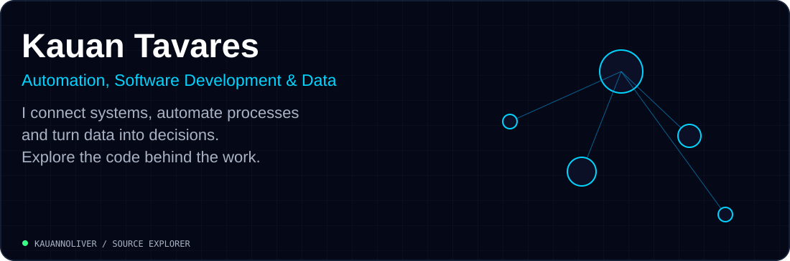
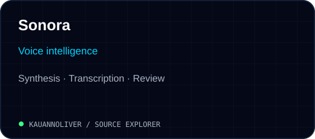
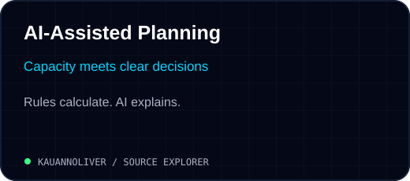
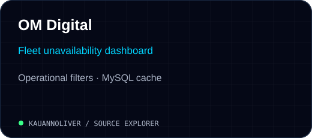
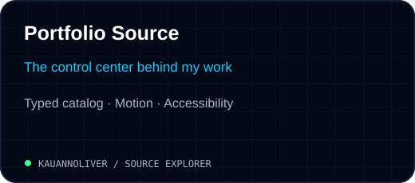
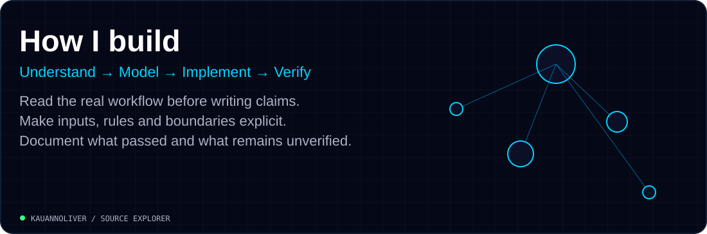

  <picture>
  <source media="(max-width: 600px)" srcset="assets/hero-mobile.svg" />
  
  </picture>

  <a href="https://kauan-tavares-dev.vercel.app/">Portfolio &amp; case studies</a> ·
  <a href="https://www.linkedin.com/in/kauan-tavares49">LinkedIn</a> ·
  <a href="mailto:kauanotavares123@gmail.com">Email</a> ·
  <a href="#project-index">Project index</a>

I build practical software around real workflows: process automation, web applications, integrations and data tools. My repositories range from browser extensions and Python desktop utilities to full-stack platforms and AI-assisted interfaces.

**Python and TypeScript** are recurring tools. I care about explicit rules, understandable architecture and documentation grounded in the code. Application interfaces may remain in Portuguese; the repository guides are in English.

## Selected work

The planning platform uses a deterministic scheduling engine with optional AI interpretation. Offer Scout separates AI-assisted editorial copy from private bot assistance. OM Digital is a maintenance-unavailability dashboard. The repository guides describe their actual boundaries.

## Public repository signals

These are repository facts, not business-impact claims. A single daily workflow reads public GitHub metadata. It updates the assets only when the values change and preserves the previous valid files if collection fails. [Source and methodology](scripts/update_metrics.py) · [Machine-readable totals](assets/metrics.json)

<strong>Engineering approach</strong>

- **Automation:** explicit inputs, validation, traceable outputs and operator review where needed.
- **Full-stack systems:** separate UI, domain rules, persistence and external-service boundaries.
- **AI features:** distinguish model interpretation from deterministic calculations; document provider and data boundaries.
- **Verification:** name the checks performed and the integrations that still require an authorized environment.

<strong>Technologies across the work</strong>

| Area | Tools used in the repositories |
| --- | --- |
| Web interfaces | React, Next.js, TypeScript, JavaScript, Vite, Tailwind CSS |
| Services | NestJS, FastAPI, Express, Laravel |
| Data | PostgreSQL, MySQL, SQL Server, Prisma, SQLite, pandas |
| Automation | Python, Playwright, Selenium, Chrome Extensions, openpyxl |
| AI and voice | Groq, GPT-OSS integrations, Whisper, ElevenLabs, OpenAI-compatible SDK |
| Local applications | Flet, Tkinter, PyQt, IndexedDB, Dexie |

The list describes tools present in different projects; it is not a certification or a claim that every repository uses the whole stack.

## Project index

<strong>Explore all public project sources</strong>

### Applications and AI

- [Sonora — Voice Intelligence](https://github.com/KauannOliver/sonora) — A two-in-one voice workspace for speech synthesis and batch transcription.
- [AI-Assisted Project Planning](https://github.com/KauannOliver/ai-assisted-project-planning) — Capacity-aware project prioritization, scheduling and narrative analysis.
- [Offer Scout](https://github.com/KauannOliver/offer-scout) — Offer discovery, price history, explainable ranking and reviewed Telegram publishing.
- [World Cup Prediction League](https://github.com/KauannOliver/world-cup-prediction-league) — Full-stack tournament predictions, group and knockout stages, scoring and administration.
- [InvestK](https://github.com/KauannOliver/investk) — A local-first personal investment portfolio and analysis application.
- [My Workout](https://github.com/KauannOliver/my-workout) — An offline-capable training planner with resumable workout sessions.
- [Pizzeria Order Manager](https://github.com/KauannOliver/pizzeria-order-manager) — Desktop customer, menu and order management with documents and optional notifications.
- [Request Management Portal](https://github.com/KauannOliver/request-management-portal) — A request-tracking application with ownership, Kanban workflow, deadlines and audit views.
- [AI Study Assistant](https://github.com/KauannOliver/ai-study-assistant) — A browser extension for extracting study questions and reviewing AI-assisted suggestions.
- [Budget Assistant for Telegram](https://github.com/KauannOliver/budget-assistant-telegram) — A conversational budgeting assistant with tool-based SQL queries and local conversation history.
- [Closed-Eye Monitor](https://github.com/KauannOliver/closed-eye-monitor) — A computer-vision experiment that tracks sustained closed-eye detections and plays an alert.

### Automation and integrations

- [Protheus Budget Integration](https://github.com/KauannOliver/protheus-budget-integration) — A desktop workflow for validating budget workbooks and sending organized records to Protheus APIs.
- [Operational Documentation Extractor](https://github.com/KauannOliver/operational-docs-extractor) — A Selenium utility for exporting selected authenticated documentation pages as text.
- [Payroll and Provisions Consolidator](https://github.com/KauannOliver/payroll-provisions-consolidator) — A desktop tool for standardizing payroll and provision spreadsheets into consolidated output bases.
- [Invoice Status Checker](https://github.com/KauannOliver/invoice-status-checker) — A desktop workflow that checks invoice status in an authenticated portal and updates a workbook.
- [Maintenance Alert Bot](https://github.com/KauannOliver/maintenance-alert-bot) — A periodic MySQL monitor that deduplicates anomalies and sends Telegram alerts.
- [Invoice Importer Extension](https://github.com/KauannOliver/invoice-importer-extension) — A browser extension that validates spreadsheet rows and fills an invoice form after manual login.
- [Transport Document Status Checker](https://github.com/KauannOliver/transport-document-status-checker) — Browser-assisted transport-document consultation with spreadsheet results.
- [Invoice Eligibility Processor](https://github.com/KauannOliver/invoice-eligibility-processor) — Spreadsheet processing with operation-specific invoice eligibility and due-date rules.
- [Spreadsheet to SharePoint](https://github.com/KauannOliver/spreadsheet-to-sharepoint) — Operator-assisted spreadsheet entry into a configured SharePoint list form.
- [Spreadsheet to Portal](https://github.com/KauannOliver/spreadsheet-to-portal) — Python desktop automation for filling a configured web portal from spreadsheet rows.
- [Brazil Toll Plaza Scraper](https://github.com/KauannOliver/brazil-toll-plaza-scraper) — Extracts toll-plaza tables into normalized spreadsheet output.

### Data tools and web interfaces

- [OM Digital — Fleet Unavailability Dashboard](https://github.com/KauannOliver/om-digital) — A maintenance-unavailability dashboard with operational filters and cached MySQL queries.
- [Enterprise Indicators Portal](https://github.com/KauannOliver/enterprise-indicators-portal) — A React portal prototype for selecting and viewing a configured report catalog.
- [Business Reporting Portal](https://github.com/KauannOliver/fpa-reports) — A Next.js and Supabase reporting-portal implementation with configurable report access.
- [FIPE Truck Explorer](https://github.com/KauannOliver/fipe-truck-explorer) — A browser interface for exploring truck reference prices, favorites and comparisons.
- [FIPE Data Collector](https://github.com/KauannOliver/fipe-data-collector) — A Python collector that exports vehicle reference-price data to Excel.
- [Financial Provision Manager](https://github.com/KauannOliver/financial-provision-manager) — Desktop management of provisions, reversals and spreadsheet outputs.
- [Excel Sheet Processor](https://github.com/KauannOliver/excel-sheet-processor) — A desktop utility for processing and exporting workbook sheets.
- [Route and Map Generator](https://github.com/KauannOliver/generator-route) — A desktop workflow for reading route workbooks and exporting maps.
- [Subcontractor Evaluation](https://github.com/KauannOliver/subcontractor-evaluation) — A spreadsheet-backed desktop interface for criteria-based evaluations.
- [Student Portal Prototype](https://github.com/KauannOliver/student-portal-prototype) — A Next.js student-portal interface prototype.
- [OMDb Movie List](https://github.com/KauannOliver/omdb-movie-list) — A browser movie-search and list interface using the OMDb API.
- [DANFE Form Demo](https://github.com/KauannOliver/danfe-form-demo) — A browser form prototype for demonstrating invoice-data entry.
- [Local Geolocation Demo](https://github.com/KauannOliver/backscan-test) — An opt-in browser geolocation demonstration with a retired forwarding endpoint.
- [Kauan Tavares — Portfolio](https://github.com/KauannOliver/kauan-tavares-portfolio) — A content-driven portfolio for automation, software development and data projects.

Some corporate source editions require an authorized local environment and have no new redistribution license. No operational records or internal reports are included. Personal original code has a license stated in its own repository; third-party licenses remain applicable.

## Let’s connect

For project context, start with the [portfolio](https://kauan-tavares-dev.vercel.app/). For a conversation, reach me on [LinkedIn](https://www.linkedin.com/in/kauan-tavares49) or [email](mailto:kauanotavares123@gmail.com).
